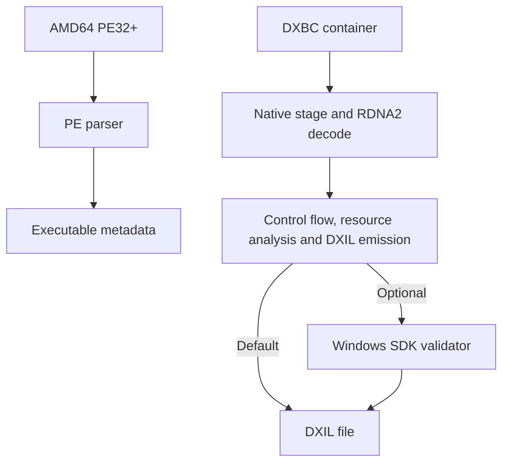

# XEMSS

**XBOX Emulator for Series S**

Open-source compatibility research for Xbox Series S software on Windows x64.

[](https://github.com/tecnofifamobile-ai/XEMSS/actions/workflows/ci.yml)
[GPL-3.0-or-later](LICENSE)

[Project status](#project-status) · [Measured baseline](#measured-baseline) · [Quick start](#quick-start) · [Command guide](#command-guide) · [How it works](#how-it-works) · [Verification](#verification) · [Road to game boot](#road-to-game-boot) · [Contribute](#contribute)

XEMSS currently ships a Rust CLI that inspects AMD64 executables and translates
supported RDNA2 shaders into DXIL for Direct3D 12. The project uses synthetic
inputs to verify each part before it becomes a dependency of the runtime.

> [!IMPORTANT]
> The current milestone is a diagnostic toolkit. Game boot and rendering are
> pending. XEMSS has yet to verify GTA VI compatibility.

## Project status

✅ Implemented and verified for the stated scope · 🟡 Implemented in part or
partially verified · 🔴 Pending a working milestone or a verified result

| Measure | Count | Scope |
| --- | ---: | --- |
| Implemented CLI commands | **4** | Inspect PE, inspect DXBC, translate one shader, or translate a directory. |
| Shader stages with a translation path | **4** | Vertex, pixel, compute, and mesh. Instruction coverage varies by stage. |
| Stages exercised end to end by the CLI fixture | **1 of 4** | Compute. The fixture generates its own console-style DXBC and checks the emitted DXIL. |
| Nonzero `image_store` channel masks verified | **15 of 15** | Read back on a four-channel float texture, using both f32 and packed f16 shader inputs. |
| D3D12 test backends exercised locally | **2** | The hardware adapter and WARP ran the synthetic f32 signed-zero regression. |
| Verified game boots | **0** | XEMSS has a synthetic test suite and a pending loader milestone. |

### Available on `main`

| Status | Capability | What works | Evidence |
| --- | --- | --- | --- |
| ✅ | Windows x64 build | The pinned Rust workspace builds with the locked dependency set. | [Windows CI](https://github.com/tecnofifamobile-ai/XEMSS/actions/workflows/ci.yml). |
| ✅ | PE32+ inspection | Reads AMD64 image metadata, imports, delay-load imports, exports, and TLS callbacks. | [CLI smoke test](apps/xemss/tests/cli.rs) and [PE parser tests](crates/victory-pe/src/image.rs). |
| ✅ | TLS metadata checks | Checks the PE32+ TLS directory, bounds callback addresses to the mapped image, and requires a terminated list. | [Synthetic TLS fixtures](crates/victory-pe/src/image.rs). |
| ✅ | DXBC inspection | Lists container sections and shader stages. Rejects parts that point into the header or offset table. | [Header-boundary regression](crates/victory-shader/src/dxbc.rs). |
| ✅ | Output handling | The CLI writes a new DXIL file and preserves any existing file at the chosen destination. | [End-to-end CLI tests](apps/xemss/tests/cli.rs). |
| ✅ | Batch shader coverage report | Attempts each native program and reports the programs written, program failures, and unreadable or invalid containers. | [Mixed-corpus CLI test](apps/xemss/tests/cli.rs). |
| ✅ | SDK validation | Checks emitted DXIL with an installed Windows SDK before writing it when `--validate` is set. | [Run the integration test with the SDK](#verification). |
| ✅ | Masked float texture stores | Maps packed RDNA2 operands to the selected components and writes zero to the remaining components of the texel. | [Shader readback regression](crates/victory-shader/src/emit/valu_tests.rs). |
| 🟡 | RDNA2 → DXIL | Translation paths exist for four stages. Coverage depends on the instructions, formats, and resource patterns in each shader. | [Stage matrix](#shader-stage-coverage) and [synthetic compute fixture](apps/xemss/tests/cli.rs). |
| 🟡 | GPU behavior | Selected synthetic shaders run through D3D12. Broader driver and game coverage is pending. | [GPU tests](crates/victory-shader/src/emit/valu_tests.rs). |

### Pending and in progress

| Status | Milestone | What will demonstrate completion |
| --- | --- | --- |
| 🔴 | PE mapping and relocation | Map a generated AMD64 image and verify that a nonpreferred base relocates its addresses. |
| 🔴 | Import binding and entry point | Resolve synthetic imports, invoke the entry point, and observe the expected result. |
| 🔴 | D3D12 bindings and submission | Bind resources and submit a synthetic draw and compute dispatch with matching pixel and buffer readbacks. |
| 🟡 | Shader instruction coverage | Reproduce reported control-flow and resource-write discrepancies and turn them into regressions. |
| 🔴 | Game boot and rendering | Collect reproducible results with authorized inputs and locate the first divergent frame or resource. |

The [roadmap](docs/roadmap.md) links the upstream reports and acceptance
criteria. The [GTA VI PC Race standings](https://vuyp.github.io/gta6-pc-race/#standings)
track other projects' reports. The evidence above belongs to XEMSS.

<details>
<summary><b>Which hosts and GPUs have coverage?</b></summary>

| Status | Host or backend | Scope |
| --- | --- | --- |
| ✅ | Windows x64 | Documented build target. GitHub Actions builds and tests the workspace on Windows. |
| 🟡 | D3D12 hardware adapter | Selected synthetic GPU tests use a Shader Model 6.6 adapter when one is available. Verify your own adapter and driver with the test suite. |
| 🟡 | WARP | The same selected tests can use Microsoft's software D3D12 adapter when it supports Shader Model 6.6. |
| 🔴 | Other platforms | Build and runtime support are unverified in XEMSS. |

</details>

## Measured baseline

Snapshot at [`70a2f97`](https://github.com/tecnofifamobile-ai/XEMSS/commit/70a2f97d6056dfad9633d132232a0e4de2444ab6)
on Windows x64 with the Windows SDK 10.0.28000.0 validator enabled for the
CLI fixture. The totals describe that revision and can be reproduced with
the commands under [Verification](#verification).

| Status | Suite | Executed and passed | Optional checks skipped | Ignored |
| --- | --- | ---: | ---: | ---: |
| ✅ | PE parser and helpers | **7** | 0 | 0 |
| 🟡 | Shader reader, translator, and GPU tests | **117** | **4** | **1** benchmark |
| ✅ | CLI integration | **3** | 0 | 0 |
| 🟡 | **Total** | **127** | **4** | **1** |

<details>
<summary><b>How the test totals were counted</b></summary>

Cargo printed **131 passed**, **0 failed**, and **1 ignored** across the
three suites. Four shader comparisons return early when the optional console
compiler is unavailable and are included in Cargo's pass count. The table
deducts those four from the number of tests that executed their checks.
The separate ignored case is a benchmark.

The CLI fixture verifies one compute program on the local SDK. The GPU suite
checks synthetic shader behavior. Neither supplies a count of translated
commercial shaders, supported titles, or measured game frame rates.

</details>

## Quick start

Install [rustup](https://rustup.rs/), the MSVC C++ build tools, and a Windows
SDK on Windows x64. The repository pins Rust in
[`rust-toolchain.toml`](rust-toolchain.toml).

```powershell
git clone https://github.com/tecnofifamobile-ai/XEMSS.git
Set-Location XEMSS
cargo build --release --locked

$xemss = '.\target\release\xemss.exe'
& $xemss --help
& $xemss inspect-pe $xemss
```

The last command examines the executable you just built. Its output begins
with `AMD64 PE32+ image` and lists the entry-point RVA and metadata counts.

## Command guide

Open an example to see its input, flags, and expected output. Run the commands
from the repository root after setting `$xemss` as shown in [Quick start](#quick-start).

<details>
<summary><b>Inspect a PE and list imported symbols</b></summary>

```powershell
& $xemss inspect-pe $xemss --imports
```

Use a local AMD64 PE32+ executable or DLL as input. The report includes the
subsystem, entry-point RVA, section count, exports, and TLS callback count.
The `--imports` flag adds one line per imported symbol, including
delay-load imports. The input is read as data.

</details>

<details>
<summary><b>Inspect the stages inside a DXBC container</b></summary>

```powershell
$shader = '.\path\to\shader.dxbc'
& $xemss inspect-shader $shader
```

Replace the example path with a local, authorized shader container. The
command reports each FourCC, byte length, and file offset. For console DXIL
parts it also prints the stages and their native code sizes when available.

</details>

<details>
<summary><b>Translate a shader and validate the DXIL</b></summary>

```powershell
$shader = '.\path\to\shader.dxbc'
& $xemss translate-shader $shader --output translated.dxil --validate
```

Supply one DXBC container with a supported console program. Choose an unused
output path in an existing folder. The CLI validates the DXIL with
`dxil.dll` before publishing it when `--validate` is set. Set `VICTORY_DXIL`
to the absolute path to your Windows SDK's `dxil.dll` to select a specific
validator.

</details>

<details>
<summary><b>Translate a directory and report every failure</b></summary>

```powershell
& $xemss translate-shaders .\local\dxbc --output .\local\dxil --validate
```

Use a directory of individual, authorized DXBC files. The command reads
top-level `.dxbc` files, including uppercase extensions, and attempts each
native program in their DXIL parts. A successful output includes the source
filename, the program's ordinal, and its stage, for example
`sample.dxbc.2.Cs.dxil`.

The summary reports container and program failures separately. A failure
sets a nonzero exit code after the rest of the directory has been processed.
Successful outputs remain available and existing files are preserved.
Per-program translation timing covers IR construction and DXIL emission
after the container has been decoded. The optional SDK check and output
write run after that timer.

</details>

<details>
<summary><b>Troubleshoot common input and output errors</b></summary>

| Result | What to check |
| --- | --- |
| PE parsing fails | Confirm the input is an AMD64 PE32+ image. The inspection command reads files up to 512 MiB. |
| Shader parsing or translation fails | Supply a single DXBC container up to 64 MiB. Inspect its parts and native stages first. Translation requires a supported console program. |
| SDK validator cannot be loaded | Point `VICTORY_DXIL` to the absolute path to the x64 Windows SDK's `dxil.dll`. |
| Output cannot be published | Check that the parent directory exists and choose a path without an existing file. |

</details>

<details>
<summary><b>Read an executable inspection report</b></summary>

| Field | How to interpret it |
| --- | --- |
| Subsystem | The environment declared in the PE header, such as the Windows console subsystem. |
| Entry RVA | The entry point's offset relative to the image base. Image mapping is a separate loader milestone. |
| Sections | Number of section headers found in the image. |
| Imports | Count of imported symbols and the DLLs that provide them. |
| Delay-load DLLs | DLLs whose imports are declared in the delay-load directory. |
| Exports and TLS callbacks | Counts of exported entries and thread-local storage callbacks recorded in the image. |

Run `inspect-pe --imports` to add symbol names to the report. For a
reproducible parser issue, include the image type and the exact error output.

</details>

## How it works



The PE parser exposes image metadata to the CLI. The shader path decodes the
console's instructions, builds an intermediate representation, analyzes
control flow and resources, and emits a new DXIL container. See the
[architecture guide](docs/architecture.md) for the entry points.

### Shader stage coverage

All four rows have a translator entry path. The status measures the current
depth of verification, including which stage has a complete CLI fixture.

| Status | Stage | Translation and test scope |
| --- | --- | --- |
| 🟡 | Vertex (VS) | The emitter maps vertex inputs and outputs. A dedicated end-to-end CLI fixture is pending. |
| 🟡 | Pixel (PS) | The emitter handles pixel inputs and output signatures. The shader suite includes a synthetic constant-color draw. |
| ✅ | Compute (CS) | A generated DXBC fixture passes inspection, translation, Windows SDK validation, and output checks. Separate GPU tests verify selected compute instructions. |
| 🟡 | Mesh (MS) | The emitter handles mesh-stage metadata and outputs. Broader execution checks depend on host features and optional compilers. |

<details>
<summary><b>Follow a shader through the translator</b></summary>

1. [DXBC parsing](crates/victory-shader/src/dxbc.rs) reads the section table
   and checks that the parts fit within the declared container.
2. [Native extraction](crates/victory-shader/src/native.rs) finds the console
   program, then decodes its stage and resource metadata.
3. [Instruction and control-flow analysis](crates/victory-shader/src/ir.rs)
   builds the intermediate representation used by the emitter.
4. [DXIL emission](crates/victory-shader/src/emit/mod.rs) lowers the program
   and assembles host bytecode with its metadata.
5. [The CLI](apps/xemss/src/main.rs) optionally validates the result with the
   Windows SDK, then writes it to the chosen output path.

</details>

<details>
<summary><b>Browse the source tree</b></summary>

| Location | Responsibility |
| --- | --- |
| [`apps/xemss/`](apps/xemss/) | CLI commands, file handling, and end-to-end tests. |
| [`crates/victory-pe/`](crates/victory-pe/) | PE32+ parsing and executable metadata. |
| [`crates/victory-shader/`](crates/victory-shader/) | DXBC parsing, RDNA2 translation, DXIL emission, and GPU tests. |
| [`docs/`](docs/) | Architecture, roadmap, and source provenance. |
| [`.github/`](.github/) | Windows CI and contribution templates. |

</details>

## Verification

| Check | What it establishes |
| --- | --- |
| Parsing tests | The parsers accept known-good structures and reject the malformed cases covered by the test suite. |
| CLI integration | The CLI inspects a PE and translates a generated compute shader into a DXIL file. It preserves an existing output file if the destination is taken. |
| Optional SDK check | The installed validator accepts the DXIL emitted for the synthetic compute fixture. |
| D3D12 GPU tests | Selected translated shaders produce expected results on available hardware and WARP backends. |

<details>
<summary><b>Run the PE and shader smoke tests with generated inputs</b></summary>

```powershell
cargo test -p xemss --locked --test cli
```

To include SDK validation, replace `<version>` with the installed SDK version.

```powershell
$env:XEMSS_TEST_DXIL = 'C:\Program Files (x86)\Windows Kits\10\bin\<version>\x64\dxil.dll'
cargo test -p xemss --locked --test cli
```

The test writes its temporary fixtures itself. The synthetic compute program
exercises container parsing, shader translation, and output publication.

</details>

<details>
<summary><b>Run the full test suite and read the results</b></summary>

```powershell
cargo test --workspace --locked -- --nocapture
```

The inherited shader suite reports skipped checks when a backend or optional
compiler is unavailable. When reporting a result, include the Git revision,
Windows version, adapter, driver, and any skipped checks. See
[Windows CI runs](https://github.com/tecnofifamobile-ai/XEMSS/actions/workflows/ci.yml)
for results tied to individual commits.

</details>

<details>
<summary><b>Reproduce the measured baseline or isolate one regression</b></summary>

To record an ordered test log with optional checks visible, run the suite with
one test thread. Use the same SDK setting as in the CLI smoke test above to
include the validator.

```powershell
cargo test --workspace --locked -- --test-threads=1 --nocapture
```

Use a filter when working on container parsing or GPU arithmetic.

```powershell
cargo test -p victory-shader --locked dxbc::tests
cargo test -p victory-shader --locked max_and_min_order_negative_zero_below_positive_zero -- --nocapture
```

| Setting | Affects |
| --- | --- |
| `VICTORY_DXIL` | Windows SDK validator selected by the CLI and shader utilities. |
| `XEMSS_TEST_DXIL` | Enables the CLI integration fixture's validation path with the specified SDK DLL. |
| `VICTORY_WARP=1` | Selects WARP in the D3D12 test helper. Leave it unset when recording results for the hardware adapter. |
| `VICTORY_CONSOLE_DXC` | An already installed console compiler for optional shader comparisons. |
| `VICTORY_PC_DXC` | Overrides the desktop shader compiler used by those comparisons. |

</details>

## Road to game boot

The loader, graphics runtime, and shader translator will each have a workload
with an observable result. This makes it possible to isolate failures before
testing a full title.

| Status | Next proof | Evidence to record |
| --- | --- | --- |
| 🔴 | Run a synthetic AMD64 entry point | Mapping base, relocation result, bound imports, and expected return value. |
| 🔴 | Submit a small D3D12 workload | Resource bindings, command submission result, and expected buffer or pixel bytes. |
| 🟡 | Close shader regressions | A minimal instruction sequence, expected channel or lane values, and readback on available backends. |
| 🔴 | Measure shader compile throughput | Translation time, DXIL size, and cold D3D12 pipeline creation time for the same inputs. |
| 🔴 | Verify a first game frame | Exact revision, host, adapter, driver, first failing stage, and reproducible result. |

<details>
<summary><b>Compare results with other projects</b></summary>

Use upstream reports to choose a small test case, then record the XEMSS
result independently. The [roadmap](docs/roadmap.md) links the current
investigations.

- VIctory has reports on [descriptor slots retained after binding failures](https://github.com/Marvisak/VIctory/issues/911)
  and [helper-lane control flow](https://github.com/Marvisak/VIctory/issues/908).
- XCL tracks [signed-zero ordering in floating-point min/max](https://github.com/ivall/xcl/issues/1282).
  XEMSS's f32 harness checks its own DXIL behavior. A separate
  [XEMSS pull request](https://github.com/tecnofifamobile-ai/XEMSS/pull/1)
  records verification for f16.
- [XCL #1269](https://github.com/ivall/xcl/issues/1269) discusses direct DXIL
  emission and the cost of EXEC handling. XEMSS already emits DXIL directly
  and preserves lane predicates where the control-flow analysis requires them.
  Its [bitcode benchmark](crates/victory-shader/src/emit/bitcode.rs) measures
  serialization of synthetic modules. Batch mode now records per-program
  translation time. Cold driver pipeline timings are pending.
- [XCL #1315](https://github.com/ivall/xcl/pull/1315) and
  [#1316](https://github.com/ivall/xcl/pull/1316) profile a compact dispatcher
  for unusually repetitive compute shaders. XEMSS now assigns decoded
  instructions to blocks in address order and rejects a late-resolved
  target that has no decoded instruction. A compact emitter would need
  independent GPU readback and pipeline timings on XEMSS inputs.

</details>

## Contribute

- [Report a reproducible failure](https://github.com/tecnofifamobile-ai/XEMSS/issues/new/choose)
  with the command, expected result, actual output, and a synthetic reproducer if possible.
- [Review open changes](https://github.com/tecnofifamobile-ai/XEMSS/pulls)
  or use the [contributor guide](CONTRIBUTING.md) to prepare a pull request.
- Read the [source and asset policy](docs/provenance.md) before sharing test data.
  Keep commercial executables, game assets, firmware, keys, and proprietary SDK
  files outside the repository.

## Credits and license

The PE and shader libraries derive from [VIctory](https://github.com/Marvisak/VIctory).
[XCL](https://github.com/ivall/xcl) serves as a public behavior reference.
The [provenance guide](docs/provenance.md) records the exact upstream revisions
and retained notices. XEMSS is distributed under [GPL-3.0-or-later](LICENSE).

[Back to top](#xemss)
