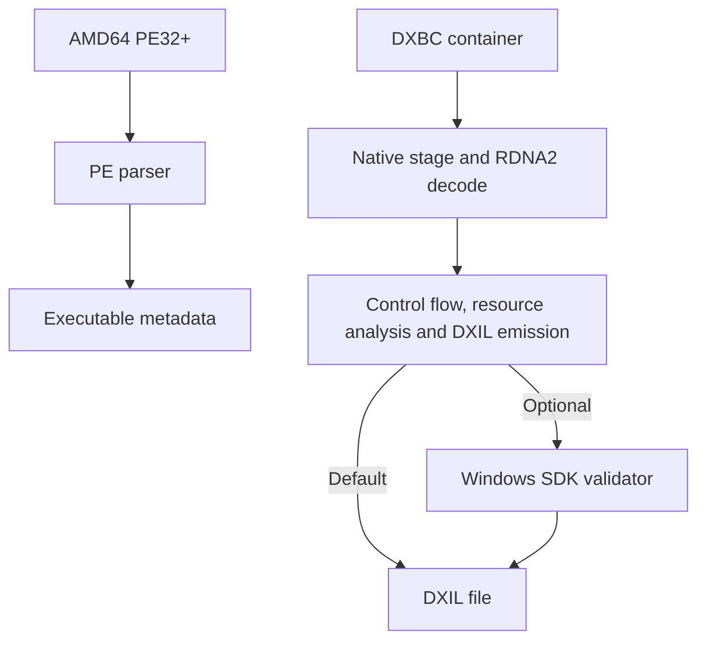

# XEMSS

**XBOX Emulator for Series S**

Open-source compatibility research for Xbox Series S software on Windows x64.

[](https://github.com/tecnofifamobile-ai/XEMSS/actions/workflows/ci.yml)
[GPL-3.0-or-later](LICENSE)

[Project status](#project-status) · [Quick start](#quick-start) · [Command guide](#command-guide) · [How it works](#how-it-works) · [Verification](#verification) · [Contribute](#contribute)

XEMSS currently ships a Rust CLI that inspects AMD64 executables and translates
supported RDNA2 shaders into DXIL for Direct3D 12. The project uses synthetic
inputs to verify each part before it becomes a dependency of the runtime.

> [!IMPORTANT]
> The current milestone is a diagnostic toolkit. Game boot and rendering are
> pending. XEMSS has yet to verify GTA VI compatibility.

## Project status

### Available on `main`

| Capability | What works | Evidence |
| --- | --- | --- |
| PE32+ inspection | Reads AMD64 image metadata, imports, delay-load imports, exports, and TLS callbacks. | [CLI smoke test](apps/xemss/tests/cli.rs) and [PE parser tests](crates/victory-pe/src/image.rs). |
| DXBC inspection | Lists container sections and shader stages. Rejects parts that point into the header or offset table. | [Header-boundary regression](crates/victory-shader/src/dxbc.rs). |
| RDNA2 → DXIL | Emits DXIL for supported vertex, pixel, compute, and mesh programs. | [Synthetic compute fixture](apps/xemss/tests/cli.rs) exercises the complete CLI path. |
| SDK validation | Checks the emitted DXIL with an installed Windows SDK before writing the file when `--validate` is set. | [Run the integration test with the SDK](#verification). |

### Pending

| Milestone | What will demonstrate completion |
| --- | --- |
| AMD64 loader | Map and relocate a generated PE, resolve synthetic imports, and call its entry point. |
| D3D12 runtime | Bind resources, submit a synthetic draw and compute dispatch, and verify both readbacks. |
| Broader shader coverage | Reproduce reported control-flow and resource-write discrepancies and turn them into regressions. |
| Game boot and rendering | Collect reproducible results with authorized inputs and locate the first divergent frame or resource. |

The [roadmap](docs/roadmap.md) links the upstream reports and acceptance
criteria. The [GTA VI PC Race standings](https://vuyp.github.io/gta6-pc-race/#standings)
track other projects' reports. The evidence above belongs to XEMSS.

<details>
<summary><b>Which hosts and GPUs have coverage?</b></summary>

| Host or backend | Scope |
| --- | --- |
| Windows x64 | Documented build target. GitHub Actions builds and tests the workspace on Windows. |
| D3D12 hardware adapter | Selected synthetic GPU tests use a Shader Model 6.6 adapter when one is available. Verify your own adapter and driver with the test suite. |
| WARP | The same selected tests can use Microsoft's software D3D12 adapter when it supports Shader Model 6.6. |
| Other platforms | Build and runtime support are unverified in XEMSS. |

</details>

## Quick start

Install [rustup](https://rustup.rs/), the MSVC C++ build tools, and a Windows
SDK on Windows x64. The repository pins Rust in
[`rust-toolchain.toml`](rust-toolchain.toml).

```powershell
git clone https://github.com/tecnofifamobile-ai/XEMSS.git
Set-Location XEMSS
cargo build --release --locked

$xemss = '.\target\release\xemss.exe'
& $xemss --help
& $xemss inspect-pe $xemss
```

The last command examines the executable you just built. Its output begins
with `AMD64 PE32+ image` and lists the entry-point RVA and metadata counts.

## Command guide

Open an example to see its input, flags, and expected output. Run the commands
from the repository root after setting `$xemss` as shown in [Quick start](#quick-start).

<details>
<summary><b>Inspect a PE and list imported symbols</b></summary>

```powershell
& $xemss inspect-pe $xemss --imports
```

Use a local AMD64 PE32+ executable or DLL as input. The report includes the
subsystem, entry-point RVA, section count, exports, and TLS callback count.
The `--imports` flag adds one line per imported symbol, including
delay-load imports. The input is read as data.

</details>

<details>
<summary><b>Inspect the stages inside a DXBC container</b></summary>

```powershell
$shader = '.\path\to\shader.dxbc'
& $xemss inspect-shader $shader
```

Replace the example path with a local, authorized shader container. The
command reports each FourCC, byte length, and file offset. For console DXIL
parts it also prints the stages and their native code sizes when available.

</details>

<details>
<summary><b>Translate a shader and validate the DXIL</b></summary>

```powershell
$shader = '.\path\to\shader.dxbc'
& $xemss translate-shader $shader --output translated.dxil --validate
```

Supply one DXBC container with a supported console program. Choose an unused
output path in an existing folder. The CLI validates the DXIL with
`dxil.dll` before publishing it when `--validate` is set. Set `VICTORY_DXIL`
to the absolute path to your Windows SDK's `dxil.dll` to select a specific
validator.

</details>

<details>
<summary><b>Troubleshoot common input and output errors</b></summary>

| Result | What to check |
| --- | --- |
| PE parsing fails | Confirm the input is an AMD64 PE32+ image. The inspection command reads files up to 512 MiB. |
| Shader parsing or translation fails | Supply a single DXBC container up to 64 MiB. Inspect its parts and native stages first. Translation requires a supported console program. |
| SDK validator cannot be loaded | Point `VICTORY_DXIL` to the absolute path to the x64 Windows SDK's `dxil.dll`. |
| Output cannot be published | Check that the parent directory exists and choose a path without an existing file. |

</details>

## How it works



The PE parser exposes image metadata to the CLI. The shader path decodes the
console's instructions, builds an intermediate representation, analyzes
control flow and resources, and emits a new DXIL container. See the
[architecture guide](docs/architecture.md) for the entry points.

<details>
<summary><b>Browse the source tree</b></summary>

| Location | Responsibility |
| --- | --- |
| [`apps/xemss/`](apps/xemss/) | CLI commands, file handling, and end-to-end tests. |
| [`crates/victory-pe/`](crates/victory-pe/) | PE32+ parsing and executable metadata. |
| [`crates/victory-shader/`](crates/victory-shader/) | DXBC parsing, RDNA2 translation, DXIL emission, and GPU tests. |
| [`docs/`](docs/) | Architecture, roadmap, and source provenance. |
| [`.github/`](.github/) | Windows CI and contribution templates. |

</details>

## Verification

| Check | What it establishes |
| --- | --- |
| Parsing tests | The parsers accept known-good structures and reject the malformed cases covered by the test suite. |
| CLI integration | The CLI inspects a PE and translates a generated compute shader into a DXIL file. It preserves an existing output file if the destination is taken. |
| Optional SDK check | The installed validator accepts the DXIL emitted for the synthetic compute fixture. |
| D3D12 GPU tests | Selected translated shaders produce expected results on available hardware and WARP backends. |

<details>
<summary><b>Run the PE and shader smoke tests with generated inputs</b></summary>

```powershell
cargo test -p xemss --locked --test cli
```

To include SDK validation, replace `<version>` with the installed SDK version.

```powershell
$env:XEMSS_TEST_DXIL = 'C:\Program Files (x86)\Windows Kits\10\bin\<version>\x64\dxil.dll'
cargo test -p xemss --locked --test cli
```

The test writes its temporary fixtures itself. The synthetic compute program
exercises container parsing, shader translation, and output publication.

</details>

<details>
<summary><b>Run the full test suite and read the results</b></summary>

```powershell
cargo test --workspace --locked -- --nocapture
```

The inherited shader suite reports skipped checks when a backend or optional
compiler is unavailable. When reporting a result, include the Git revision,
Windows version, adapter, driver, and any skipped checks. See
[Windows CI runs](https://github.com/tecnofifamobile-ai/XEMSS/actions/workflows/ci.yml)
for results tied to individual commits.

</details>

## Contribute

- [Report a reproducible failure](https://github.com/tecnofifamobile-ai/XEMSS/issues/new/choose)
  with the command, expected result, actual output, and a synthetic reproducer if possible.
- [Review open changes](https://github.com/tecnofifamobile-ai/XEMSS/pulls)
  or use the [contributor guide](CONTRIBUTING.md) to prepare a pull request.
- Read the [source and asset policy](docs/provenance.md) before sharing test data.
  Keep commercial executables, game assets, firmware, keys, and proprietary SDK
  files outside the repository.

## Credits and license

The PE and shader libraries derive from [VIctory](https://github.com/Marvisak/VIctory).
[XCL](https://github.com/ivall/xcl) serves as a public behavior reference.
The [provenance guide](docs/provenance.md) records the exact upstream revisions
and retained notices. XEMSS is distributed under [GPL-3.0-or-later](LICENSE).

[Back to top](#xemss)
