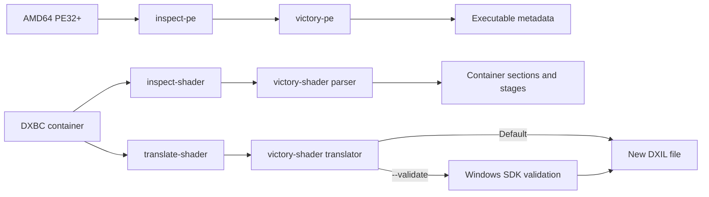

# Architecture

XEMSS is a Rust workspace built around one Windows x64 CLI and two libraries
ported from VIctory. The CLI reads local files, chooses the parser or translator,
and reports the result.

| Component | Entry point | Test location |
| --- | --- | --- |
| CLI | [`apps/xemss/src/main.rs`](../apps/xemss/src/main.rs) | [CLI integration tests](../apps/xemss/tests/cli.rs) |
| Executable parser | [`crates/victory-pe/src/lib.rs`](../crates/victory-pe/src/lib.rs) | Unit tests in [`victory-pe/src`](../crates/victory-pe/src/) |
| Shader parser and translator | [`crates/victory-shader/src/lib.rs`](../crates/victory-shader/src/lib.rs) and [DXIL emitter](../crates/victory-shader/src/emit/mod.rs) | Unit and GPU tests in [`victory-shader/src`](../crates/victory-shader/src/) |

`inspect-pe` reads the image as data and reports metadata. `inspect-shader`
parses the container and reports the shader stages it can identify.
`translate-shader` takes a supported RDNA2 program through instruction
decoding, intermediate representation, control-flow and resource analysis,
and DXIL emission. If requested, the SDK validator checks the emitted
container before the CLI publishes it to a new output path.

The [roadmap](roadmap.md) covers the loader and D3D12 runtime needed for
execution and rendering. The [provenance guide](provenance.md) records the
imported revisions and source policy.
